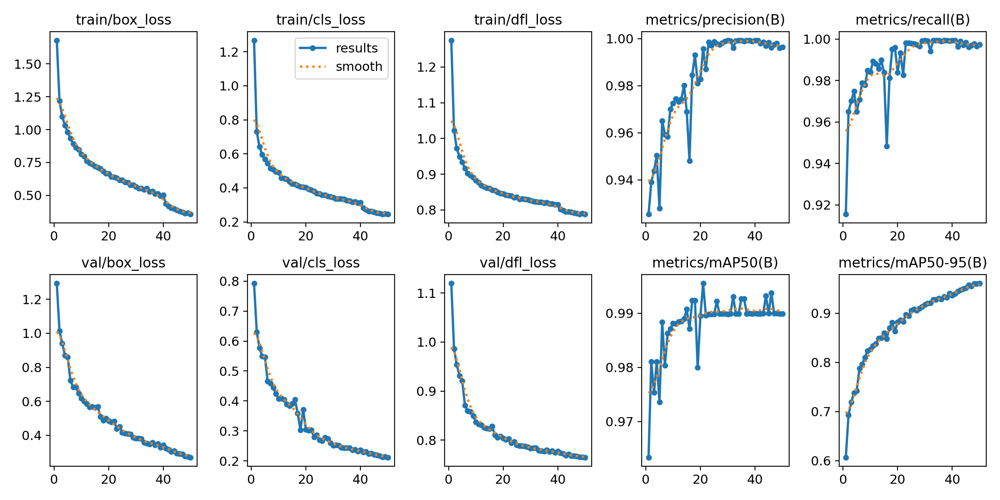
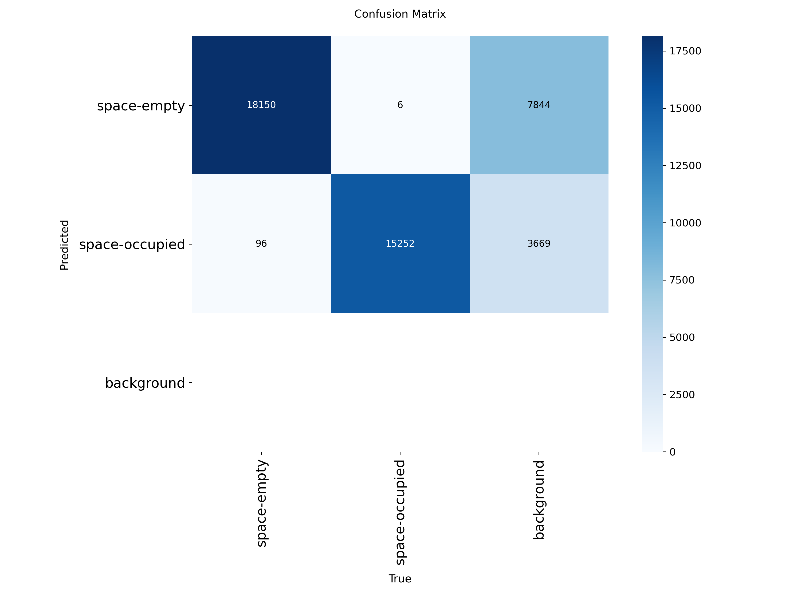

# Kelompok 03

1. Mahda Annisa              2408107010036
2. M. Rayan Zishan           2408107010063
3. Zanna Zikraana            2408107010094
4. Cut Farah Salsabila       2408107010100
 
# 🅿️ Smart Parking Detection (YOLO11)

Sistem deteksi ketersediaan slot parkir otomatis (*kosong* vs *terisi*) berbasis *Computer Vision* menggunakan arsitektur **YOLO11** dan antarmuka web interaktif berbasis **Streamlit**.

Proyek ini melatih model deteksi objek pada subset siang hari (**12:00:00 – 15:00:59**) dari dataset PKLot untuk mengenali status masing-masing slot parkir secara langsung pada gambar area parkir.

---

## ✨ Fitur Utama

- **Filter Otomatis Berbasis Timestamp:** Menyaring gambar dan anotasi COCO secara otomatis berdasarkan waktu pengambilan gambar (`12:00:00` – `15:00:59`).
- **Konversi Pipeline COCO ke YOLO:** Mengonversi label *bounding box* dan memetakan dua kelas utama:
  - `0`: `space-empty` (Slot Kosong)
  - `1`: `space-occupied` (Slot Terisi)
- **Deteksi Cepat & Ringan:** Menggunakan model `yolo11n` yang ringan sehingga dapat dijalankan secara *real-time* baik menggunakan GPU maupun CPU lokal.
- **Aplikasi Web Streamlit (`app.py`):** Antarmuka unggah gambar dengan pengaturan *confidence threshold*, visualisasi kotak deteksi, ringkasan okupansi parkir, serta ekspor hasil deteksi.

---

## 📊 Hasil Pelatihan & Evaluasi

Model dilatih selama **50 epoch** (`imgsz=640`) pada lingkungan GPU Tesla T4 dan dievaluasi pada *test set* (**303 gambar**, **17.340 instance slot parkir**).

### Metrik Evaluasi Test Set

| Kelas | Jumlah Gambar | Jumlah Instance | Precision | Recall | mAP@50 | mAP@50-95 |
| :--- | :---: | :---: | :---: | :---: | :---: | :---: |
| **All** | 303 | 17.340 | **0.989** | **0.979** | **0.988** | **0.959** |
| `space-empty` | 252 | 9.741 | 0.995 | 0.960 | 0.989 | 0.963 |
| `space-occupied` | 256 | 7.599 | 0.983 | 0.999 | 0.987 | 0.954 |

### Kurva Pelatihan (`results.png`)

> *Catatan: Pastikan file gambar hasil pelatihan disimpan di folder `assets/` dengan nama `results.png` dan `confusion_matrix.png` (atau sesuaikan path gambar di bawah ini).*



### Confusion Matrix (`confusion_matrix.png`)



---

## 📁 Struktur Proyek

```text
smart-parking-detection/
├── app.py                               # Aplikasi web Streamlit untuk inferensi lokal
├── Smart_Parking_Detection_Notebook.ipynb # Notebook preprocessing, konversi, & training
├── models/
│   └── best.pt                          # Bobot model YOLO11 terbaik hasil training
├── assets/
│   ├── results.png                      # Grafik metrik & loss selama training
│   └── confusion_matrix.png             # Matriks evaluasi prediksi model
├── requirements.txt                     # Daftar dependensi Python
└── README.md
```

---

## 🚀 Cara Menjalankan di Lokal

### 1. Clone Repositori
```bash
git clone https://github.com/username-kamu/smart-parking-detection.git
cd smart-parking-detection
```

### 2. Buat Virtual Environment & Install Dependensi
```bash
python -m venv venv

# Windows:
venv\Scripts\activate

# Linux / macOS:
source venv/bin/activate

pip install ultralytics streamlit opencv-python-headless pillow numpy PyYAML
```

### 3. Pastikan Bobot Model Tersedia
Letakkan file bobot hasil pelatihan (`best.pt`) di dalam folder `models/`:
```text
models/best.pt
```

### 4. Jalankan Aplikasi Streamlit
```bash
streamlit run app.py
```
Buka browser pada alamat lokal yang muncul (default: `http://localhost:8501`), lalu unggah foto area parkir untuk melihat hasil deteksi dan persentase okupansi.

---

## ⚠️ Batasan & Catatan Metodologi

- **Cakupan Waktu Data:** Penyaringan dataset hanya menggunakan informasi jam dari timestamp nama file (`12:00:00` – `15:00:59`).
- **Variasi Lingkungan & Sudut Kamera:** Metadata JSON yang digunakan tidak memuat atribut eksplisit untuk sudut kamera (*camera angle*) maupun kondisi cuaca; oleh karena itu performa pada kondisi pencahayaan malam atau sudut kamera yang sangat berbeda memerlukan pengujian lanjutan.
- **Sifat Prediksi:** Jumlah slot kosong dan terisi dihitung berdasarkan objek yang terdeteksi oleh model pada ambang batas *confidence* tertentu dan merupakan hasil prediksi, bukan penghitungan fisik absolut.
